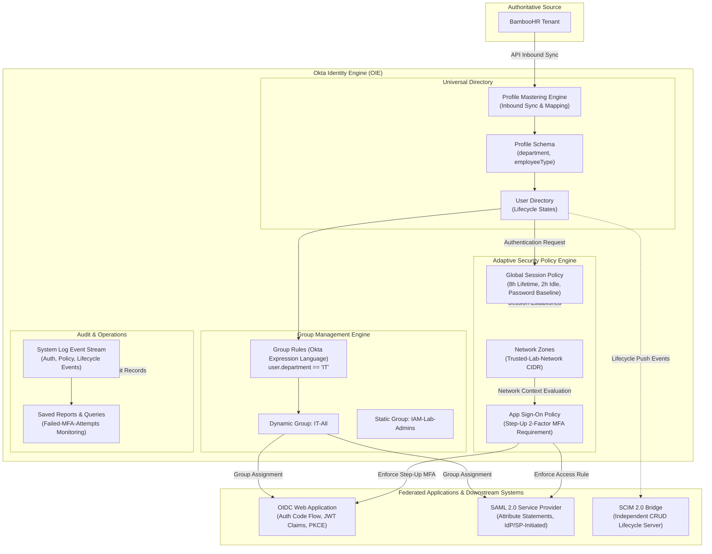

# Okta Identity & Access Management Lab

This repository documents an enterprise Identity and Access Management (IAM) environment deployed on the Okta Identity Engine (OIE) platform. The deployment covers inbound identity lifecycle management, Universal Directory schema design, dynamic attribute-driven group automation, modern federation with OpenID Connect (OIDC) and SAML 2.0, multi-layered adaptive access policies, and audit logging.

## Architecture

The following diagram illustrates the identity flow, directory architecture, federation endpoints, policy enforcement checkpoints, and monitoring integrations implemented across this environment.

## Skills Demonstrated

- **Identity Lifecycle Management**: Configured inbound profile mastering from BambooHR via REST API integration, established automated user creation and matching rules, and validated schema attribute authority.
- **Directory Schema Design**: Extended Okta Universal Directory base schemas with custom business attributes (`department`, `employeeType`) to support downstream access governance.
- **Dynamic Access Governance**: Built automated group membership rules using Okta Expression Language (OEL) to eliminate manual group curation risks.
- **OpenID Connect Implementation**: Configured confidential OIDC Web Applications, completed live Authorization Code flows, executed back-channel token exchanges, and decoded JWT assertions claim-by-claim.
- **SAML 2.0 Federation**: Established SAML integrations with custom attribute statements, validated both IdP-initiated and SP-initiated SSO journeys, and resolved routing errors through protocol trace inspection.
- **Adaptive Access Policies**: Implemented a defense-in-depth policy framework combining Global Session Policies, application-specific step-up authentication rules, and IP-based Network Zones.
- **Security Monitoring and Auditing**: Built targeted System Log queries to audit authentication flows, trace policy evaluation decisions, and track suspicious authentication failures.

## Project Structure

Documentation for each deployment phase is available in the `docs/` directory:

| Phase | Title | Summary | Documentation Link |
| :--- | :--- | :--- | :--- |
| 01 | Org Setup & Baseline Configuration | Tenant provisioning, admin console architecture, and Universal Directory schema extensions. | [01-org-setup.md](docs/01-org-setup.md) |
| 02 | Users & Groups Simulation | User lifecycle onboarding, BambooHR profile mastering, and dynamic Okta Expression Language group rules. | [02-users-groups.md](docs/02-users-groups.md) |
| 03 | OIDC Application Integration | OIDC Web App setup, Authorization Code exchange, JWT payload analysis, and PKCE comparison. | [03-oidc.md](docs/03-oidc.md) |
| 04 | SAML 2.0 Integration & Troubleshooting | Federation with SAML 2.0, assertion attribute statements, flow analysis, and a STAR troubleshooting case study. | [04-saml.md](docs/04-saml.md) |
| 05 | Authentication & Security Policies | Multi-factor authenticator enrollment, Global Session Policies, step-up MFA, and Network Zones. | [05-security-policies.md](docs/05-security-policies.md) |
| 06 | Provisioning & Lifecycle Architecture | Architectural review of SCIM 2.0 lifecycle management and reference to custom SCIM Bridge service. | [06-provisioning.md](docs/06-provisioning.md) |
| 07 | Monitoring, Logs & Threat Detection | System Log event sequence tracing, failure tracking queries, and saved security reports. | [07-monitoring-logs.md](docs/07-monitoring-logs.md) |

## Image Assets

All original screenshots from the deployment have been organized by phase with descriptive identifiers under `images/`:
- `images/01-org-setup/`: Tenant setup, console tour, and schema extension captures.
- `images/02-users-groups/`: User onboarding, BambooHR API integration, mapping, and group rules.
- `images/03-oidc/`: OIDC registration, Postman token exchange, and JWT inspection.
- `images/04-saml/`: SAML configuration, assertion testing, and troubleshooting captures.
- `images/05-security-policies/`: Authenticator enrollment, session rules, and network zones.
- `images/07-monitoring-logs/`: Audit log traces, failure queries, and bookmark configurations.

Feel free to navigate across all Phases (each phase has exercices)
