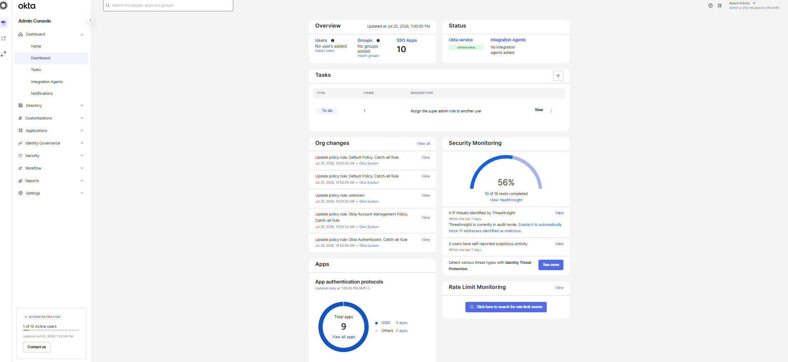
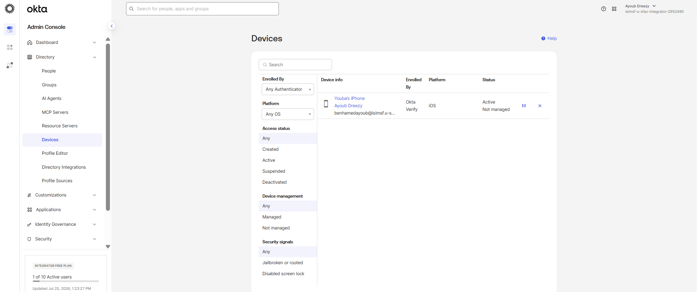
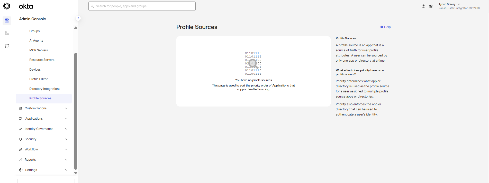
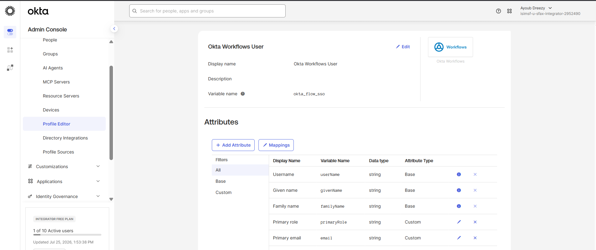
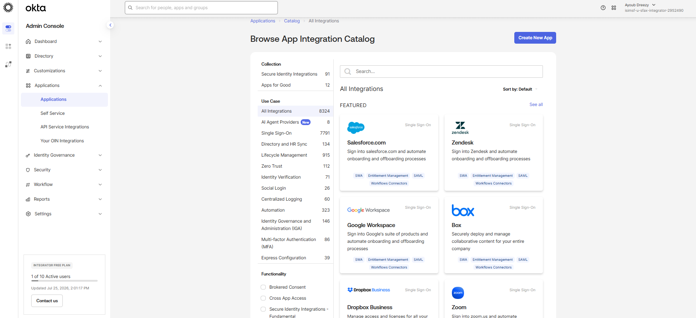
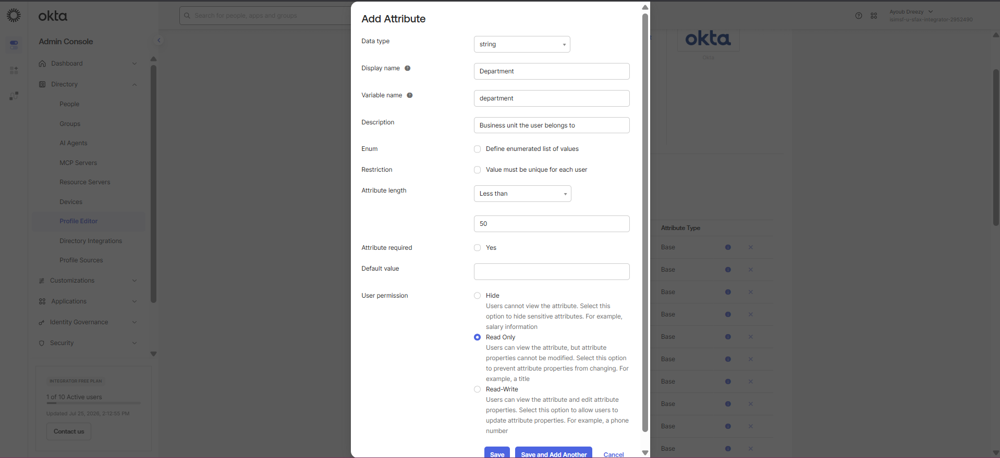
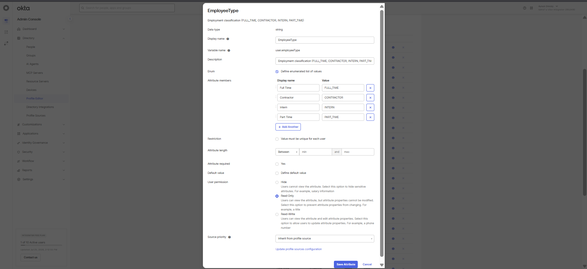

# Phase 1: Org Setup & Baseline Configuration

## Overview

I established a new Okta tenant using the Integrator Free Plan running on the Okta Identity Engine (OIE) platform. This phase involved touring the core administrative console and extending the base Universal Directory schema with custom user attributes required for downstream group automation and policy enforcement.

## Tenant Provisioning & Console Architecture

The Okta Integrator Free Plan tenant provides access to Universal Directory, Single Sign-On, Adaptive MFA, Lifecycle Management, and API Access Management. This platform runs natively on Okta Identity Engine (OIE), which replaces legacy Classic Engine constructs with unified authenticators, Global Session Policies, and App Sign-On Policies.

Upon initial activation and enrollment of an administrative authenticator, I accessed the Admin Console dashboard.

I reviewed the administrative navigation menus to verify available subsystems across the tenant:

- **Dashboard**: High-level status overview, operational notifications, and recent administrative actions.
- **Directory**: User repositories, groups, profile definitions, directory agents, and profile sources.
- **Applications**: Federation integrations, OIN catalog browsing, and API service connections.
- **Security**: Authenticator management, Global Session Policies, App Sign-On Policies, and Network Zones.
- **Workflow**: Automated event triggers and flow configurations.
- **Reports**: System Log audit streams and operational reports.

During this orientation, I examined several core directory menus:

Registered endpoints and enrollment states appear under Devices:

Inbound mastering order across HR and external directories is ordered in Profile Sources:

System accounts and integration user definitions, such as Okta Workflows:

The integration catalog for pre-built SaaS connectors and custom apps:

## Universal Directory Schema Extension

Okta user profiles inherit from a base schema (`User (default)`) that contains standard identity fields such as given name, family name, username, and primary email. Enterprise environments require organizational context to govern access. Without custom attributes, access assignment must be maintained manually at the user level.

To establish attribute-based access control, I navigated to **Directory > Profile Editor**, selected the base **User (default)** profile, and added two custom attributes.

### Attribute 1: Department

I configured the `department` attribute to store the user's business unit.

| Configuration Field | Value |
| :--- | :--- |
| Data type | string |
| Display name | Department |
| Variable name | department |
| Description | Business unit the user belongs to |
| Attribute length | 1 - 50 |
| Attribute required | No |
| User permission | Read-Write |

### Attribute 2: Employee Type

I configured the `employeeType` attribute to capture employment classification, such as full-time employees, contractors, or interns.

| Configuration Field | Value |
| :--- | :--- |
| Data type | string |
| Display name | Employee Type |
| Variable name | employeeType |
| Description | Employment classification (FULL_TIME, CONTRACTOR, INTERN, PART_TIME) |
| Attribute required | No |
| User permission | Read-Only |

Setting user permission to Read-Only prevents end-user modification through self-service profile settings, ensuring that employment classifications remain authoritative.

## Design Rationale & Outcome

Extending the base directory schema establishes the foundation for automated identity governance. With `department` and `employeeType` defined at the directory layer:

1. Inbound HR integrations can map source data directly into these fields during synchronization.
2. Okta Expression Language rules can evaluate these variables dynamically to manage group memberships.
3. Downstream SAML and OIDC applications can consume these attributes as assertions or claims to drive in-app role-based authorization.
