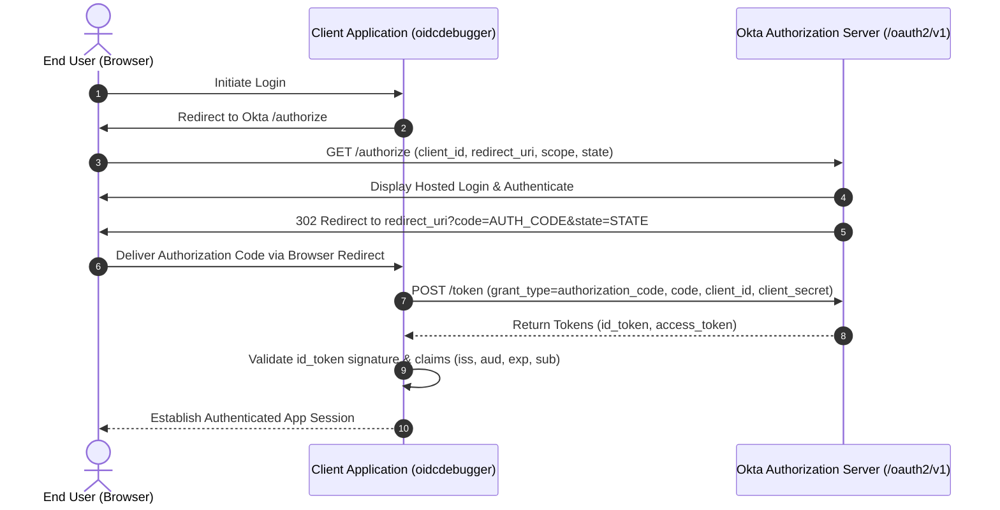
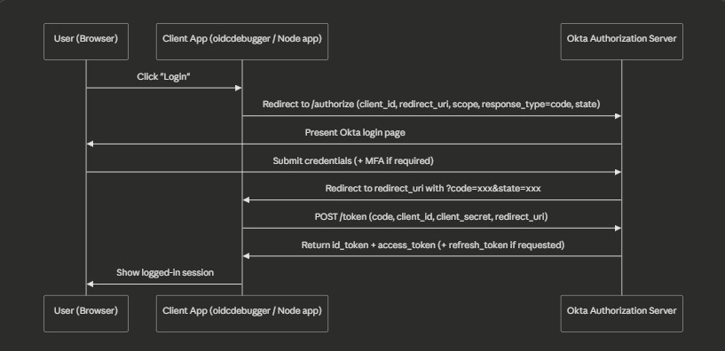
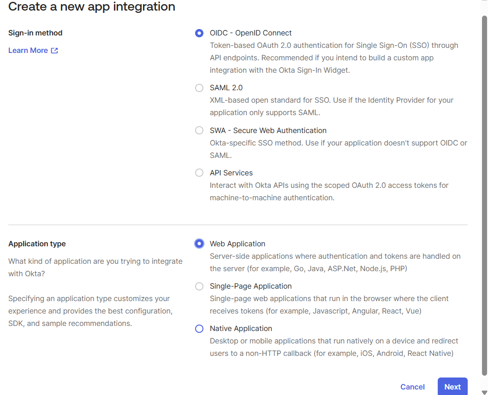
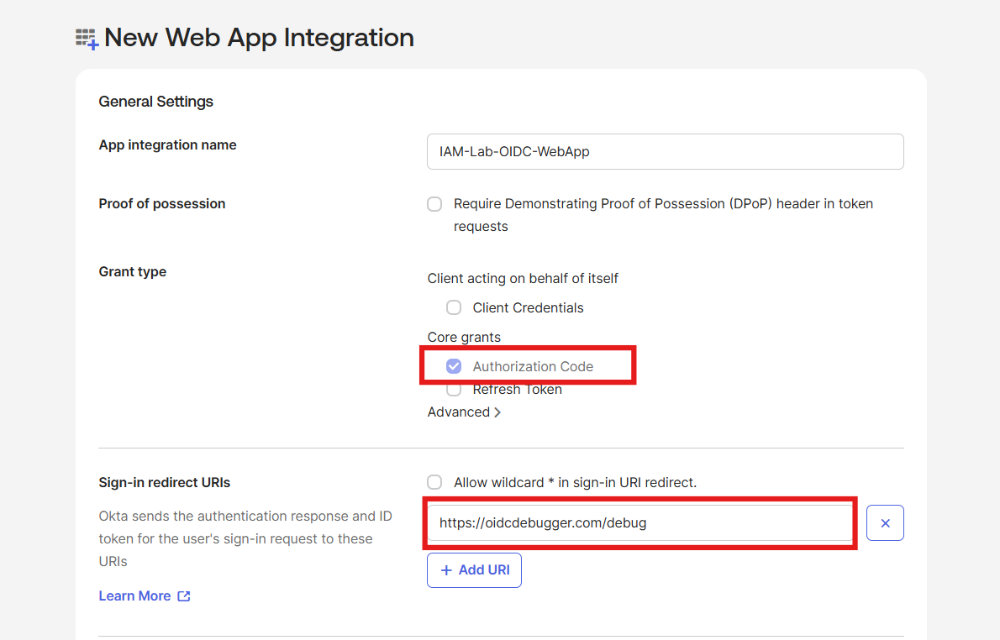
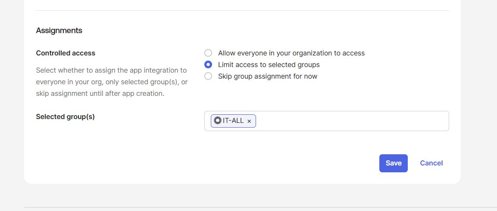
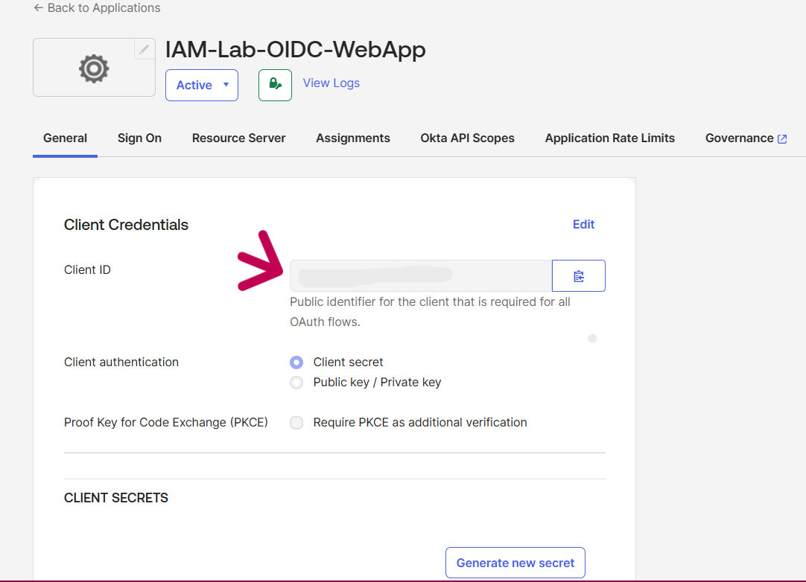
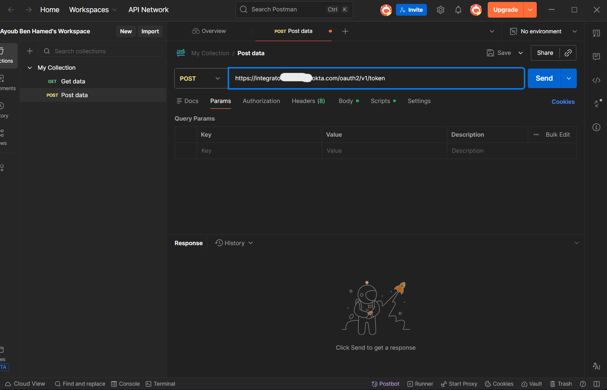
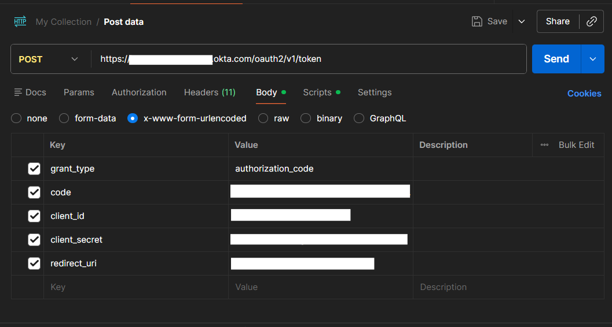
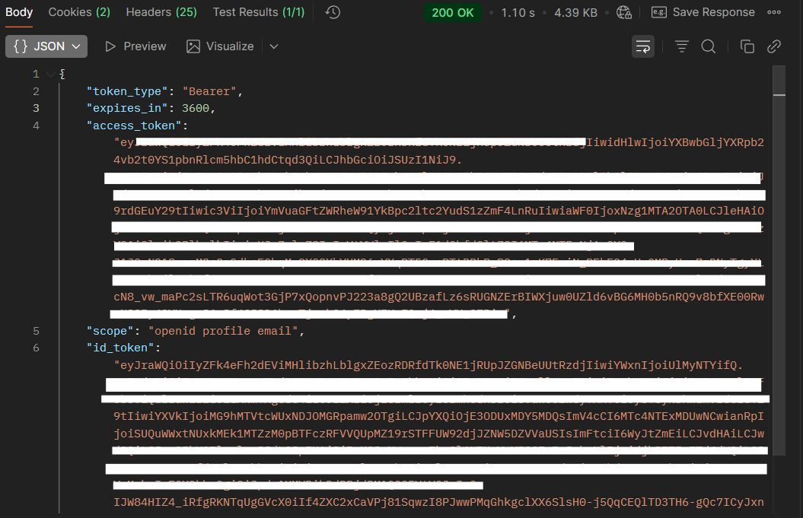
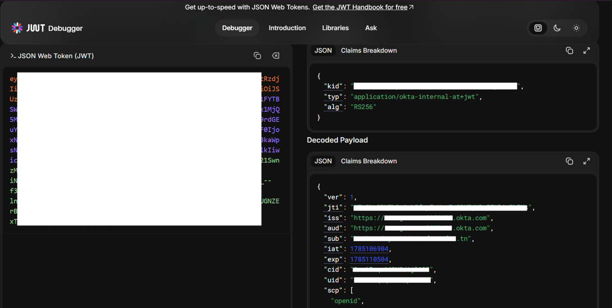

# Phase 3: OIDC Application Integration

## Overview

In this phase, I registered a confidential OpenID Connect (OIDC) Web Application in Okta, executed the complete Authorization Code flow against it, performed a back-channel token exchange, and inspected the resulting JSON Web Tokens (JWT) claim-by-claim. I also evaluated key architectural variations including Single-Page Applications with PKCE, redirect URI security restrictions, and token claim customizations.

## Protocol Mechanics

OpenID Connect adds an identity assertion layer on top of OAuth 2.0 authorization:
- OAuth 2.0 issues an Access Token that defines what resources or APIs a client application can access.
- OpenID Connect issues an ID Token, a signed JSON Web Token asserting user identity and authentication context.
- The Authorization Code flow separates user authentication from token delivery: the browser receives a short-lived, single-use authorization code, and the client application backend exchanges that code directly with the Okta token endpoint over an authenticated back-channel call.

The flow diagram reflects this separation between front-channel delegation and back-channel token issuance:

## Application Registration

I registered the application in Okta:

1. Navigated to **Applications > Applications > Create App Integration**.
2. Selected **OIDC - OpenID Connect** as the sign-in method.

3. Selected **Web Application** as the application type. Web applications possess a secure server backend capable of maintaining client confidentiality, allowing Okta to issue a Client Secret.
4. Defined application parameters:
   - **App integration name**: `IAM-Lab-OIDC-WebApp`
   - **Grant type**: Authorization Code
   - **Sign-in redirect URIs**: Configured with the test client callback URL (`https://oidcdebugger.com/debug`)

5. Under **Assignments**, I selected **Limit access to selected groups** and assigned the `IT-All` group created in Phase 2. This restricts application access strictly to authorized department members rather than permitting tenant-wide access.

6. Upon saving, Okta generated a Client ID and Client Secret.

## Authorization Code Flow Execution

I used `oidcdebugger.com` to initiate the front-channel request:

1. Populated the request parameters:
   - **Authorize URI**: `https://{myOktaDomain}/oauth2/v1/authorize`
   - **Redirect URI**: `https://oidcdebugger.com/debug`
   - **Client ID**: Generated during application setup
   - **Scope**: `openid profile email`
   - **Response type**: `code`
2. Submitted the request. The browser redirected to the Okta hosted login page.
3. Authenticated using an account belonging to the `IT-All` group.
4. Okta redirected back to `https://oidcdebugger.com/debug`, providing the short-lived authorization code.

### Back-Channel Token Exchange via Postman

With the authorization code captured, I configured a back-channel POST request in Postman to exchange the code for cryptographic tokens:

1. Set the HTTP request method to **POST** targeting the Okta token endpoint:
   `https://{myOktaDomain}/oauth2/v1/token`

2. Under the **Headers** tab, configured:
   - `Accept: application/json`
   - `Content-Type: application/x-www-form-urlencoded`
3. Under the **Body** tab (`x-www-form-urlencoded`), supplied the required OAuth parameters:
   - `grant_type`: `authorization_code`
   - `code`: The authorization code received from the front-channel redirect
   - `client_id`: The application Client ID
   - `client_secret`: The application Client Secret
   - `redirect_uri`: `https://oidcdebugger.com/debug`

4. Executed the request. The Okta token endpoint returned HTTP 200 OK containing `token_type`, `expires_in`, `access_token`, `scope`, and `id_token`.

## Token Inspection & Claim Analysis

I decoded the `id_token` on `jwt.io` to inspect the payload claims asserted by Okta:

I analyzed the core claims present in the token payload:

| Claim | Key Meaning | Value Found | Verification Check |
| :--- | :--- | :--- | :--- |
| `iss` | Issuer | `https://{myOktaDomain}/oauth2/default` | Matches the authoritative Okta authorization server URL. |
| `sub` | Subject | Unique internal user ID (UUID) | Stable identifier representing the authenticated user. |
| `aud` | Audience | Application Client ID | Must match the client application identifier exactly to prevent token replay against unintended services. |
| `exp` | Expiration | Unix timestamp | Standard expiration window (1 hour from issuance). |
| `iat` | Issued At | Unix timestamp | Issuance timestamp. |
| `auth_time` | Authentication Time | Unix timestamp | The exact time authentication took place, used by downstream apps to enforce session freshness. |
| `amr` | Auth Methods Reference | `["pwd"]` | Describes the factor categories used during login. |
| `idp` | IdP Identifier | Okta IdP identifier | Identifies the identity provider that validated credentials. |
| `name`, `email` | Profile Claims | User display name and email | Included because `profile` and `email` scopes were explicitly requested. |

I also reviewed the `access_token`. While structurally a signed JWT, its primary claim is `scp` (an array containing `openid`, `profile`, and `email`), which authorizes API operations rather than asserting identity details.

## Architectural Variations & Security Controls

### Single-Page Applications (SPA) vs. Web Applications (PKCE)

I examined how the client application architecture dictates the authentication flow. Because Single-Page Applications execute entirely within browser memory, any embedded secret is extractable. When registering an app as a Single-Page App, Okta does not issue a Client Secret and instead enforces Proof Key for Code Exchange (PKCE). The client generates a random cryptographic `code_verifier`, submits the hashed `code_challenge` during the authorization request, and presents the original verifier during token exchange to verify origin authenticity without a shared secret.

### Redirect URI Enforcement

I tested Okta's redirect validation by modifying the requested `redirect_uri` to an unapproved endpoint. Okta rejected the request directly at the `/authorize` endpoint on the Okta domain, halting execution before any code could be generated. This validation protects against authorization code interception attacks.

### Custom Groups Claims

Standard OIDC ID tokens omit group memberships by default. In an enterprise environment, applications rely on group context to assign internal roles. Under **Security > API > Authorization Servers > default > Claims**, custom claims can be defined to query directory groups and include a `groups` array in the ID token, eliminating redundant downstream API queries.
