# Phase 4: SAML 2.0 Integration & Troubleshooting

## Overview

In this phase, I established SAML 2.0 federation between Okta and an external Service Provider (`sptest.iamshowcase.com`). I configured SAML attribute statements to pass custom directory attributes, evaluated both Identity Provider (IdP) initiated and Service Provider (SP) initiated authentication flows, and resolved an intentional configuration breakdown documented as a STAR case study.

## Federation Concepts & Terminology

While OpenID Connect delivers claims in a compact JSON Web Token, SAML 2.0 packages identity claims into a signed XML document known as an assertion.

The core SAML protocol components configured in this integration map directly to standard federation primitives:

| SAML Construct | OIDC Equivalent | Functional Role |
| :--- | :--- | :--- |
| Identity Provider (IdP) | Authorization Server | Okta, the authoritative system that authenticates the user and signs assertions. |
| Service Provider (SP) | Client / Relying Party | `sptest.iamshowcase.com`, the target service consuming assertions for access decisions. |
| Entity ID | Client ID | Globally unique URI identifying the SP or IdP. |
| Assertion Consumer Service (ACS) URL | Redirect URI | Endpoint on the SP where Okta POSTs the signed SAML assertion. |
| Attribute Statements | Token Claims | Structured assertion block delivering identity attributes (`department`, `employeeType`, `email`). |
| NameID | Subject (`sub`) | The primary identity identifier in the assertion (`EmailAddress`). |

## SAML Application Registration

I configured the integration in the Okta Admin Console:

1. Navigated to **Applications > Applications > Create App Integration**.
2. Selected **SAML 2.0** as the sign-in method.

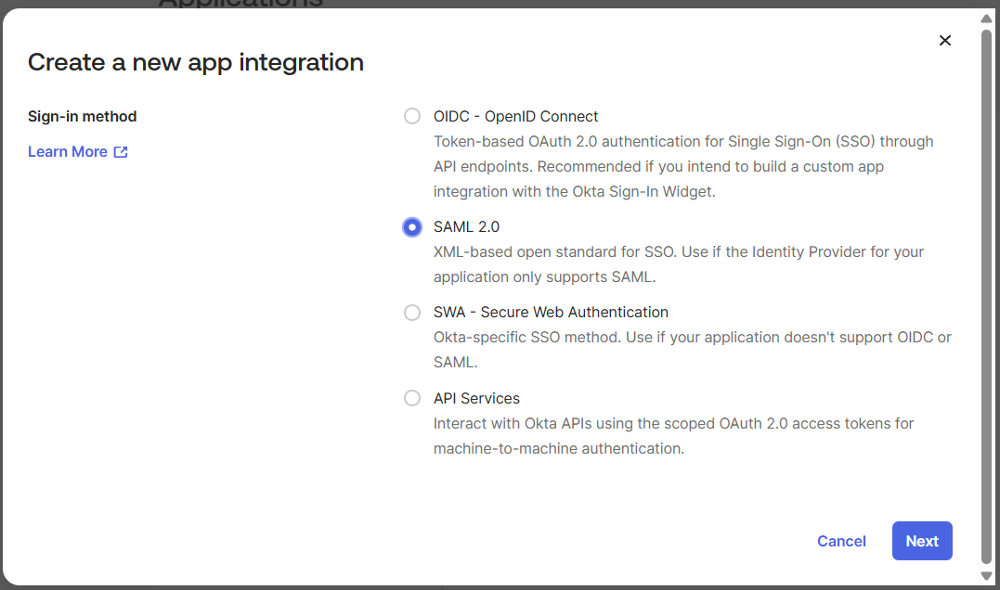

3. Entered the application label: `IAM-Lab-SAML-App`.

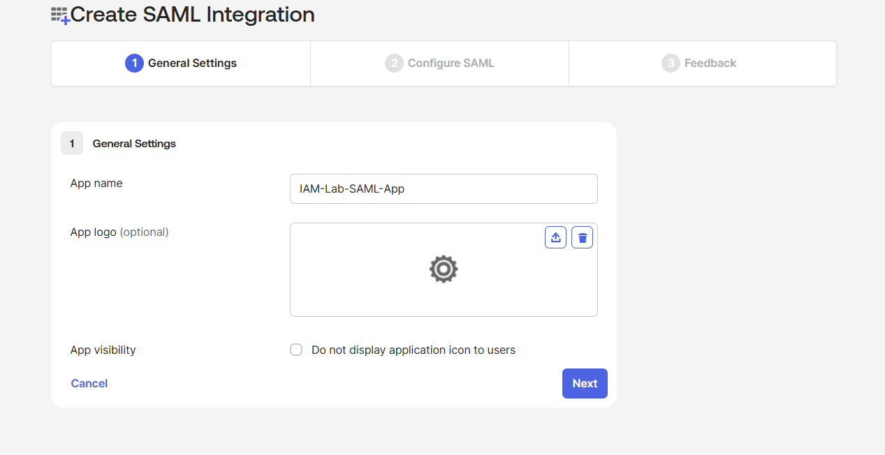

4. On the **SAML Settings** panel, configured the endpoint and routing parameters:
   - **Single sign-on URL (ACS URL)**: Entered the ACS URL specified in the SP metadata (`https://sptest.iamshowcase.com/test`).
   - **Use this for Recipient URL and Destination URL**: Checked (standard configuration for verifying assertion destination validity).

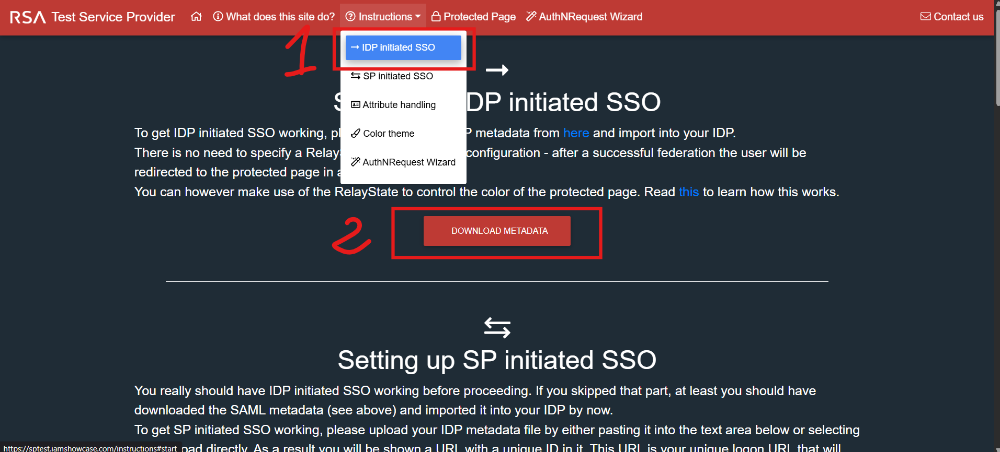

5. Configured identifier parameters:
   - **Audience URI (SP Entity ID)**: Entered the SP entity identifier (`https://sptest.iamshowcase.com/test`).
   - **Name ID format**: Set to `EmailAddress`.
   - **Application username**: Set to `Email`.

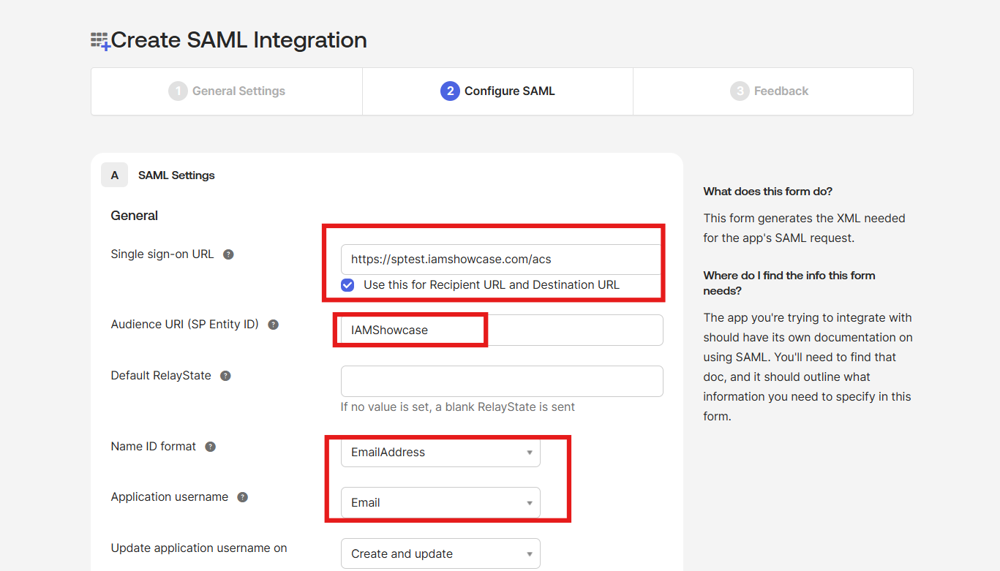

### Attribute Statements Configuration

Enterprise SaaS applications frequently rely on SAML attributes to enforce role-based access control without querying external directory APIs. I configured three Attribute Statements to push user profile attributes directly within the assertion envelope:

| Name | Name Format | Value Expression | Purpose |
| :--- | :--- | :--- | :--- |
| `department` | Unspecified | `user.profile.department` | Transmits the user's business unit for app-level role mapping. |
| `employeeType` | Unspecified | `user.profile.employeeType` | Identifies employment classification to restrict administrative features. |
| `email` | Unspecified | `user.profile.email` | Transmits primary email for contact and record reconciliation. |

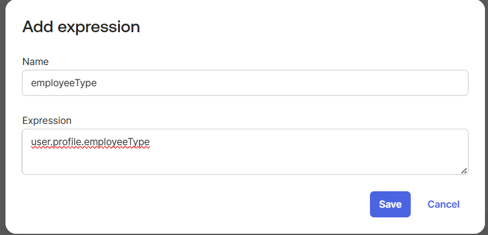

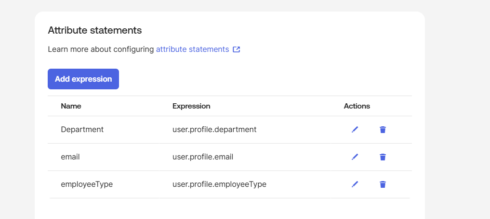

I finalized the setup and assigned the application to the dynamic `IT-All` group.

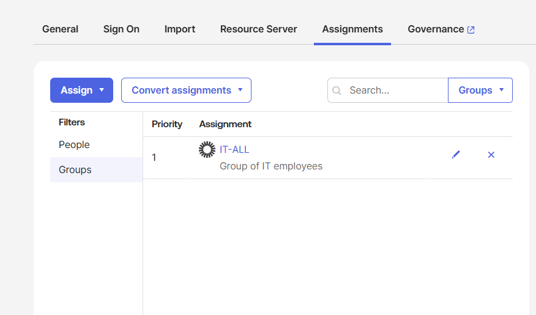

## Authentication Flow Validation

### IdP-Initiated Authentication Flow

In an IdP-initiated journey, the user begins inside Okta:

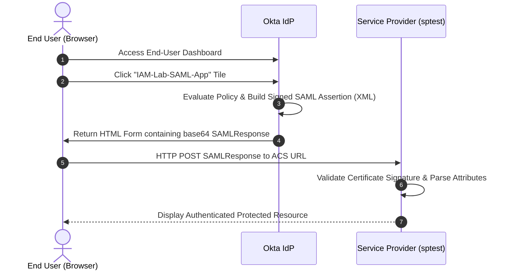

1. Logged into the Okta End-User Dashboard as a persona assigned to `IT-All`.
2. Located and clicked the `IAM-Lab-SAML-App` tile.

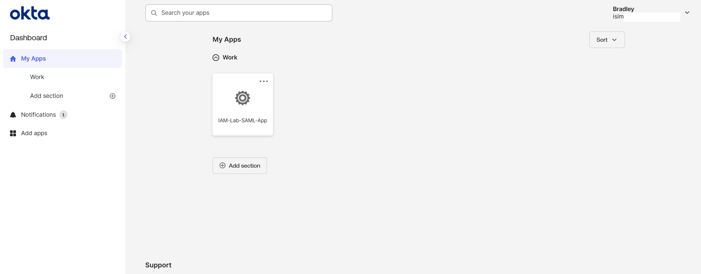

3. Okta generated the signed XML assertion and submitted an automated HTTP POST to the SP ACS URL.
4. The SP parsed the assertion, validated the signature against Okta's IdP certificate, and displayed the received identity claims, confirming proper extraction of NameID, department, and employeeType.

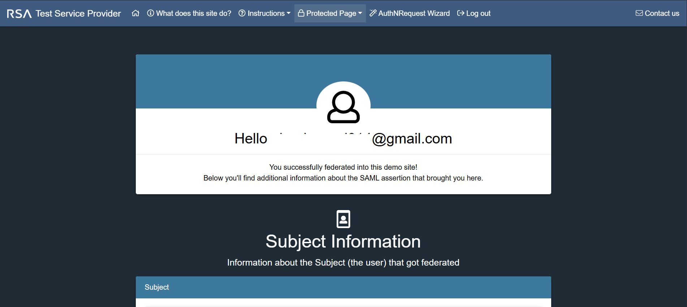

### SP-Initiated Authentication Flow

In an SP-initiated journey, the authentication request originates at the Service Provider:

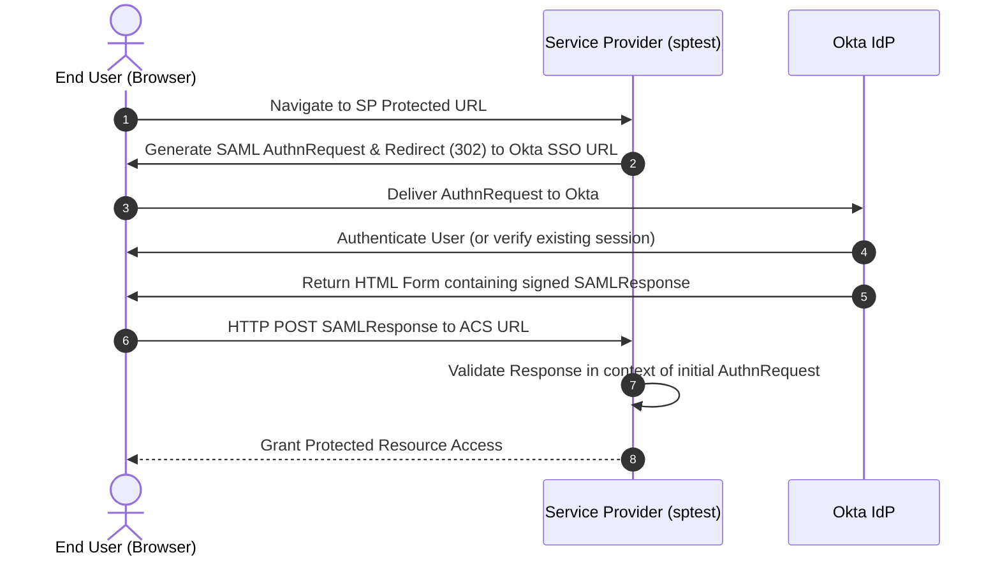

1. In the Okta application settings under the **Sign On** tab, I opened **Actions > View IdP metadata** and downloaded the IdP metadata XML file containing Okta's Entity ID, SSO endpoints, and public signing certificate.
2. Uploaded this metadata file to `sptest.iamshowcase.com/instructions`, which registered the IdP settings and generated a unique SP-initiated login URL.

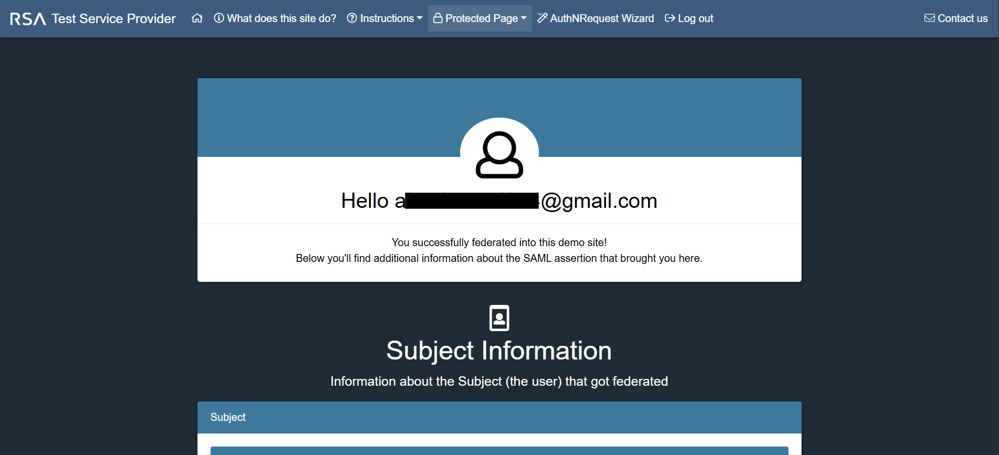

3. In a clean browser session, navigated to the generated SP-initiated link.
4. The SP redirected to Okta carrying a SAML `AuthnRequest`. After verifying credentials, Okta issued the signed assertion back to the SP ACS endpoint.
5. The SP validated the assertion and granted access.

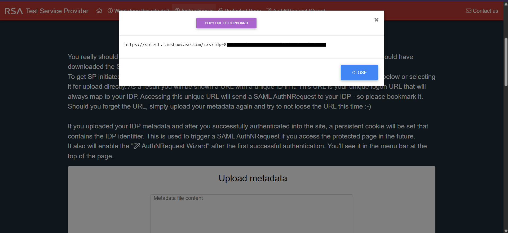

## Troubleshooting Incident: STAR Case Study

### Situation
During the deployment of the SAML 2.0 integration with `sptest.iamshowcase.com`, the federation link required validation against endpoint delivery errors to verify that failure signatures could be identified and isolated from the browser and administrative logs.

### Task
Diagnose an assertion consumption failure where authentication succeeded at the Identity Provider, but the Service Provider failed to receive or acknowledge the assertion.

### Action
1. I deliberately introduced an endpoint routing discrepancy by modifying the **Single sign-on URL** (ACS URL) under **General > SAML Settings > Edit** from `https://sptest.iamshowcase.com/test` to an invalid endpoint:
   `https://sptest.iamshowcase.com/acs-wrong`

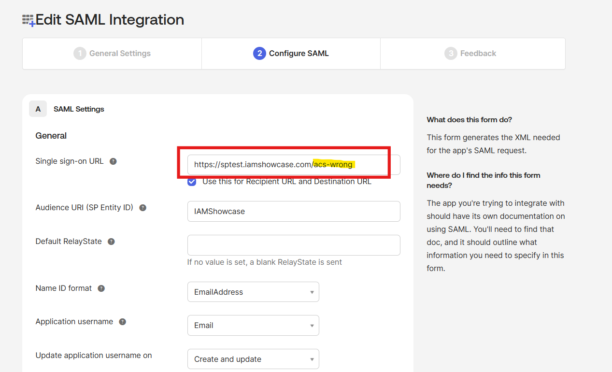

2. I initiated an IdP-initiated login from the dashboard. Okta built the assertion correctly and directed the browser to submit the base64-encoded `SAMLResponse` via HTTP POST to the invalid ACS endpoint.
3. The destination web server returned an error indicating the endpoint did not exist and could not accept the payload.

4. I reviewed the browser network trace. The failure occurred after leaving the Okta domain during the final POST delivery. This ruled out credential, signing certificate, or policy failures within Okta and pointed directly to a routing misconfiguration on the ACS URL.
5. I returned to the Okta Admin Console, restored the Single sign-on URL to `https://sptest.iamshowcase.com/test`, and saved the configuration.

### Result
Upon correcting the ACS URL, I re-executed the IdP-initiated login. The assertion was successfully delivered and accepted by the Service Provider, restoring operational single sign-on.
