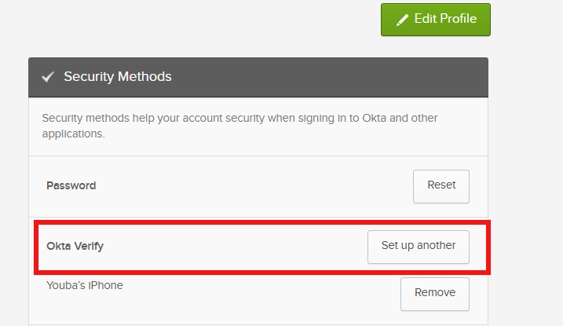
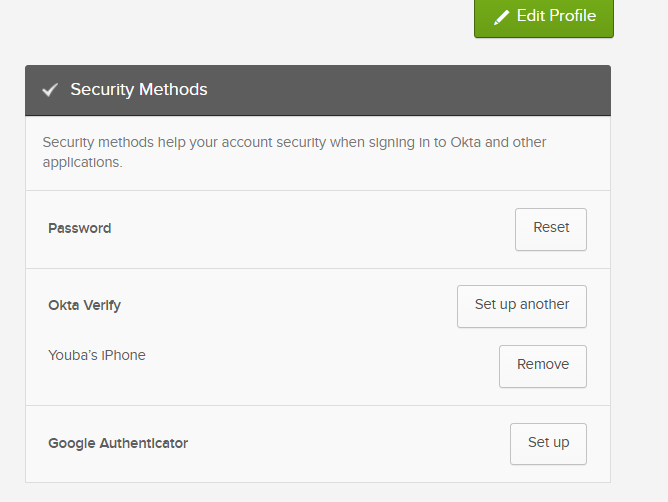
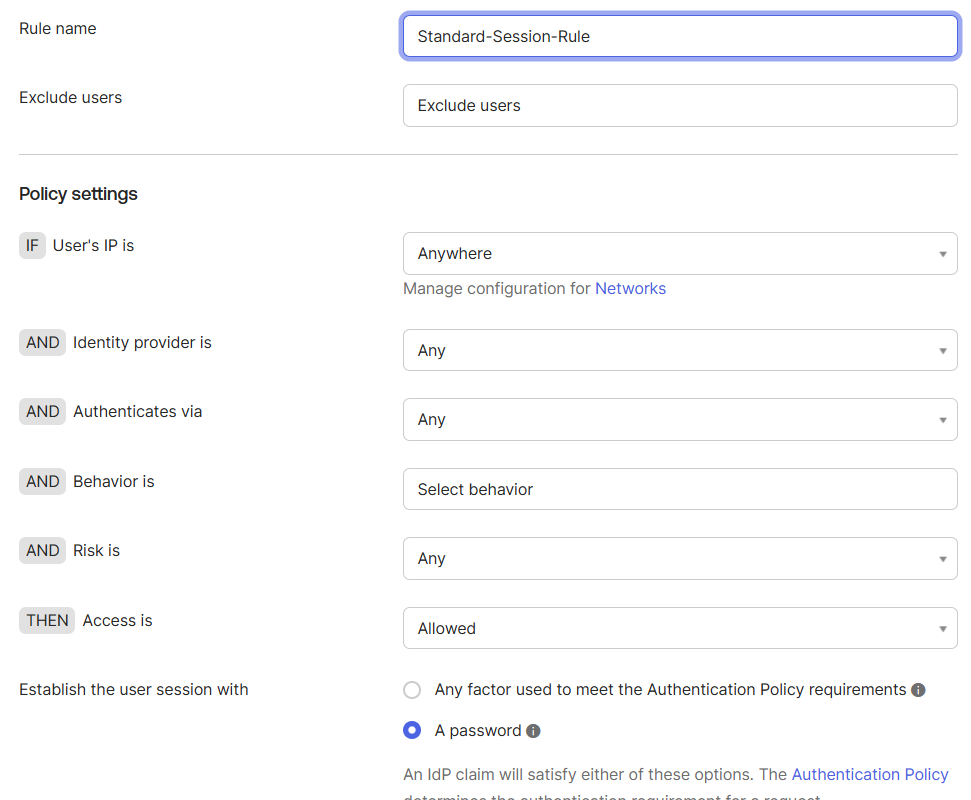
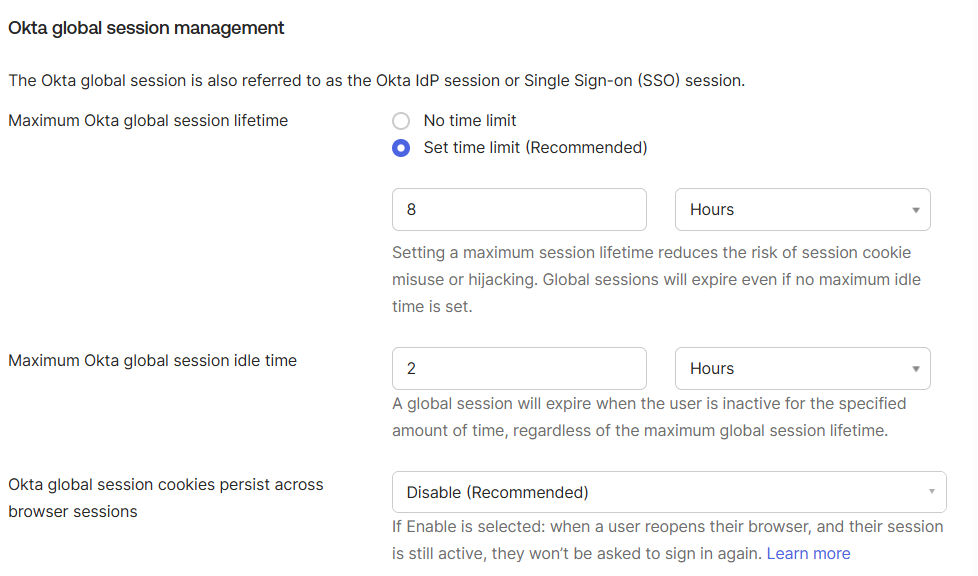
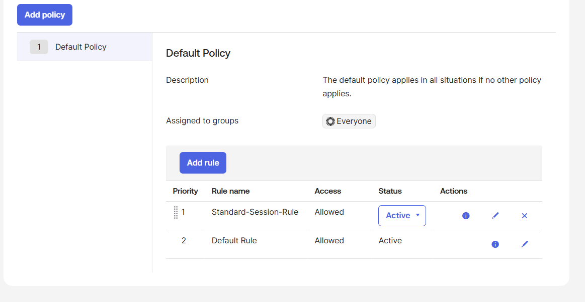
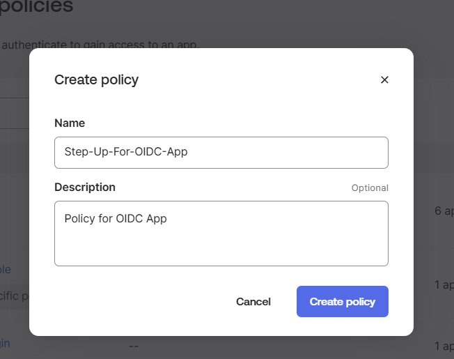
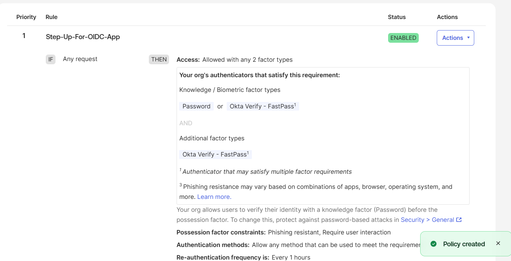
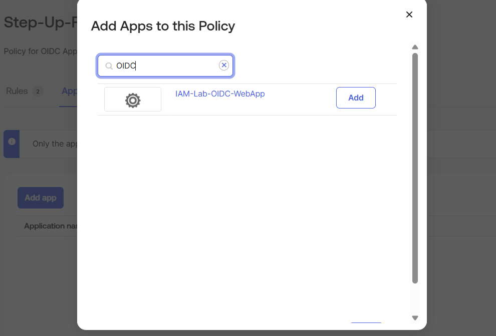
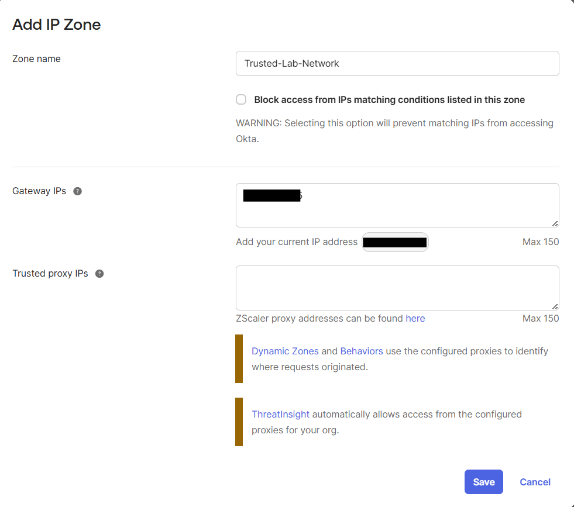
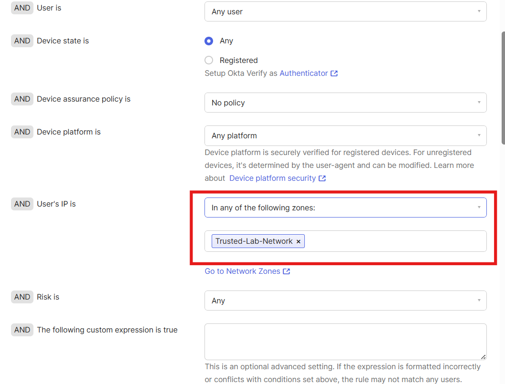

# Phase 5: Authentication & Security Policy Configuration

## Overview

In this phase, I implemented a layered access security architecture on Okta Identity Engine (OIE). I enrolled multi-factor authenticators, configured an org-wide Global Session Policy to establish baseline session boundaries, built an App Sign-On Policy to enforce step-up authentication, and applied contextual IP Network Zones to condition policy evaluation.

## Two-Tier Policy Framework

Okta Identity Engine evaluates access decisions across two distinct layers:

1. **Global Session Policy**: Evaluated first when an identity attempts to establish an Okta session. This policy sets tenant-wide authentication criteria, session lifetimes, and idle timeout limits.
2. **App Sign-On Policy**: Evaluated whenever a user with an active Okta session attempts to open a specific application. This policy enforces targeted controls, such as step-up authentication or network restrictions, without imposing friction on lower-risk applications.

| Policy Type | Evaluation Scope | Primary Objective |
| :--- | :--- | :--- |
| Global Session Policy | Tenant-wide | Determines the conditions required to establish an Okta session and maintains session lifecycle limits. |
| App Sign-On Policy | Application-specific | Determines additional requirements (e.g. 2 factor types, re-auth intervals) to access a sensitive app. |

## Authenticator Management

Policies can only enforce authenticators that users have successfully enrolled. Under **Security > Authenticators**, I reviewed available verification methods.

In end-user account settings, I confirmed enrollment of Okta Verify as a possession-based factor.

I expanded available factors by enabling Google Authenticator (Time-Based One-Time Password) in the tenant, making it available under user security methods.

Combining a knowledge factor (password) with an independent possession factor (Okta Verify push notification or TOTP) satisfies true multi-factor requirements by drawing proofs from separate authentication categories.

## Global Session Policy Configuration

I configured the org-wide session policy to govern initial session creation:

1. Navigated to **Security > Global Session Policy**.
2. Selected the **Default Policy** and added a new rule named `Standard-Session-Rule`.
3. Set the rule conditions:
   - **User's IP is**: Anywhere
   - **Establish the user session with**: A password

4. Configured session timeouts to mitigate session hijacking risks:
   - **Maximum Okta global session lifetime**: 8 Hours
   - **Maximum Okta global session idle time**: 2 Hours
   - **Okta global session cookies persist across browser sessions**: Disable

5. Positioned `Standard-Session-Rule` at Priority 1 above the catch-all Default Rule. Because policy rules evaluate from top to bottom on a first-match basis, standard users hit this rule directly.

## App Sign-On Policy: Step-Up Authentication

To protect sensitive business applications, I configured an App Sign-On Policy that mandates secondary verification before granting application access.

1. Navigated to **Security > Authentication Policies** and created a new policy named `Step-Up-For-OIDC-App`.

2. Configured the policy rule requirements:
   - **Rule Name**: `Step-Up-For-OIDC-App`
   - **Access**: Allowed with any 2 factor types
   - **Factor Requirements**: Knowledge or Biometric factor type (Password) AND Additional factor type (Okta Verify)
   - **Re-authentication frequency**: Every 1 hours

3. Assigned the policy directly to `IAM-Lab-OIDC-WebApp`.

## Contextual Access Control: Network Zones

To condition policy evaluation based on network origin, I integrated IP Network Zones into the policy framework:

1. Navigated to **Security > Network Zones > Add Zone**.
2. Configured an **IP Zone** named `Trusted-Lab-Network`:
   - Configured Gateway IPs with a `/32` CIDR representing the trusted corporate office network.

3. In the App Sign-On Policy, added a rule condition evaluating network context:
   `AND User's IP is: In any of the following zones: [Trusted-Lab-Network]`

## Policy Verification Testing

I tested the policy layers to verify expected behavior:

1. **Initial Authentication**: Navigated to the tenant sign-in page. The Global Session Policy evaluated and established an Okta session using only the primary password credential.
2. **Application Access (Step-Up)**: Selected the `IAM-Lab-OIDC-WebApp` tile. The application sign-on policy intercepted the request. Because the app requires two factor types, Okta prompted for an Okta Verify push challenge before completing the OIDC redirect.
3. **Network Context Variation**: When accessing from within `Trusted-Lab-Network`, the rule evaluated against the trusted condition. When accessing from an alternate network (simulating an untrusted off-network location), the system triggered strict secondary verification.
