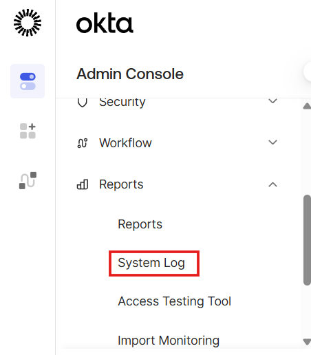
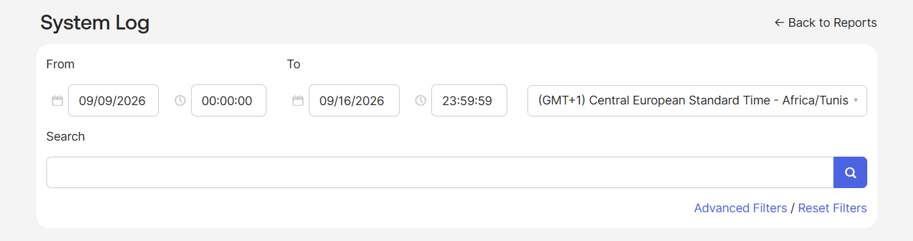
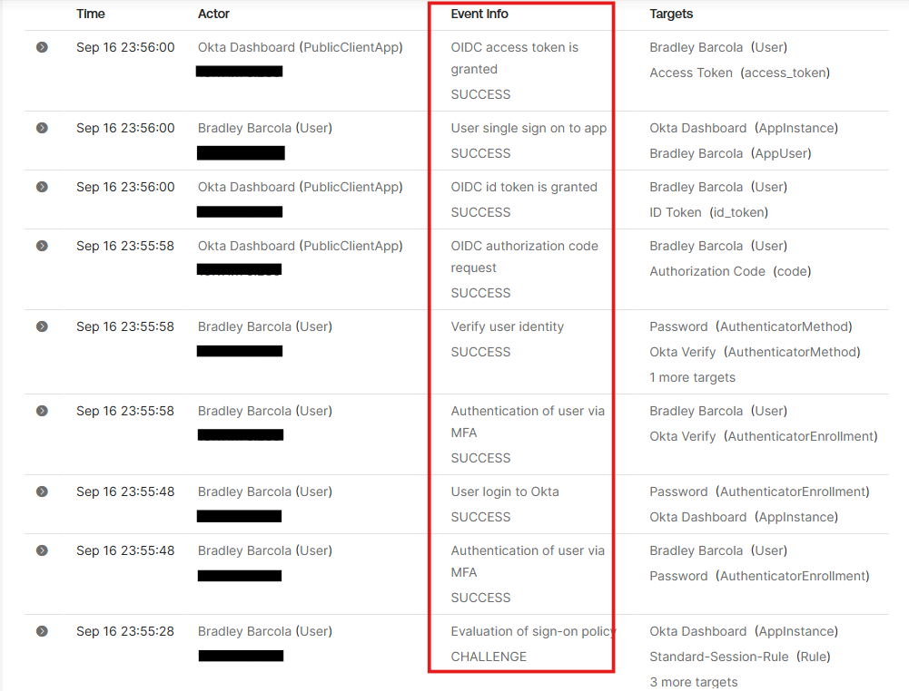
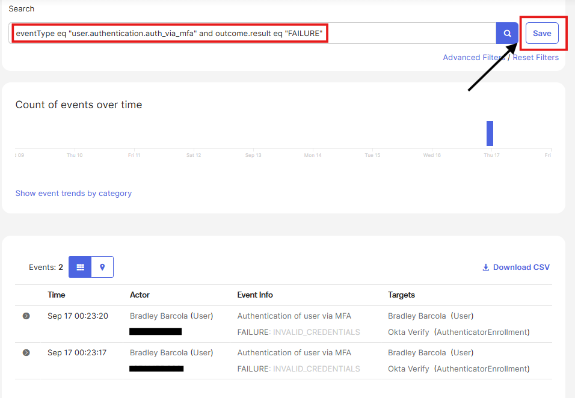
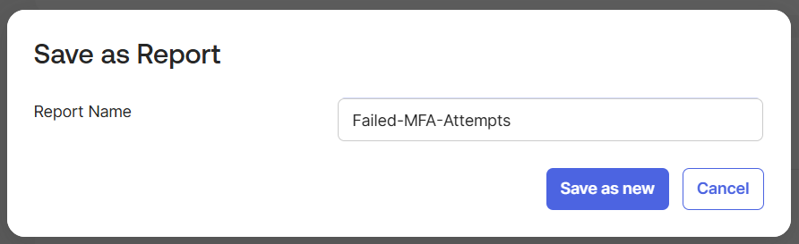
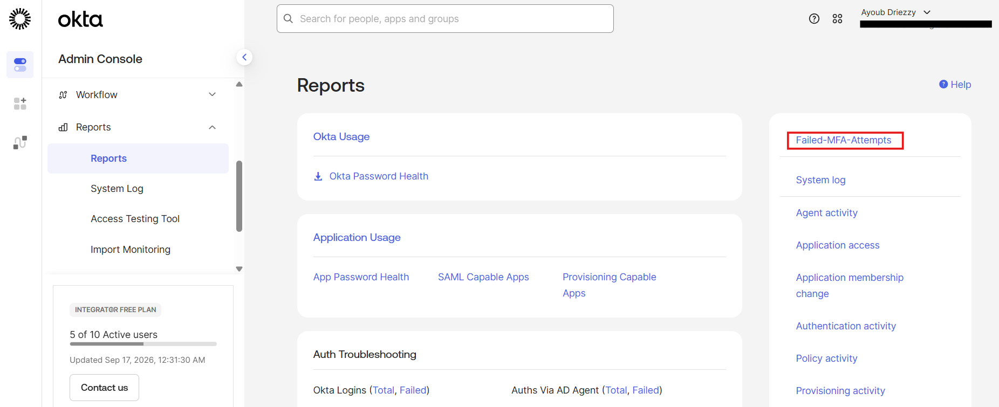

# Phase 7: Monitoring, System Log & Threat Detection

## Overview

In this phase, I utilized the Okta System Log to audit tenant activity, trace complete authentication and authorization lifecycles, and build proactive queries for threat detection. I established targeted audit filters to track failed multi-factor authentications and saved these queries as operational reports.

## System Log Architecture

The Okta System Log records an immutable, chronologically ordered event stream covering all identity operations across the tenant. Each log entry contains structured fields:

- **`eventType`**: Dot-namespaced string categorizing the action (e.g. `user.session.start`, `policy.evaluate_sign_on`).
- **`outcome.result`**: Final status (`SUCCESS`, `FAILURE`, or `CHALLENGE`).
- **`actor`**: The identity, service, or process that initiated the event.
- **`target`**: The identity, application, or resource acted upon.
- **`client`**: Client metadata including public IP address, user agent, and geographic origin.

I accessed the logging interface by navigating to **Reports > System Log**.



I configured the search bar and time range filter to isolate relevant sessions.



## End-to-End Authentication Trace

I traced an authentication and OIDC authorization flow for user Bradley Barcola to observe how policy decisions and token issuance unfold in real time.



The log captured the following sequence in chronological order:

1. **Policy Evaluation**: `policy.evaluate_sign_on` evaluated the request against `Standard-Session-Rule`, returning `CHALLENGE` to demand user credentials.
2. **Primary Factor Verification**: `user.authentication.auth_via_mfa` recorded `SUCCESS` using the user's password.
3. **Session Establishment**: `user.session.start` recorded `SUCCESS`, creating the Okta global session.
4. **App Policy Step-Up Verification**: `user.authentication.auth_via_mfa` and identity verification recorded `SUCCESS` as the user satisfied the second factor requirement using Okta Verify.
5. **Authorization Code Issuance**: `app.oauth2.as.authorize.code_grant` recorded `SUCCESS` for the OIDC authorization code request.
6. **Token Issuance**: `app.oauth2.as.token.grant.id_token` and `app.oauth2.as.token.grant.access_token` recorded `SUCCESS` as Okta returned tokens to the client application.
7. **Single Sign-On Complete**: `user.authentication.sso` recorded `SUCCESS` as application access was finalized.

## Threat Detection Query: Failed MFA Monitoring

Proactive security operations require predefined queries to detect suspicious authentication behavior before incidents escalate. A sharp increase in failed MFA attempts across multiple accounts indicates potential credential stuffing or MFA fatigue attacks, whereas isolated failures generally point to lost devices or user typos.

I constructed a focused filter to track failed MFA verification events:

```text
eventType eq "user.authentication.auth_via_mfa" and outcome.result eq "FAILURE"
```

To test the query, I generated deliberate test failures by entering incorrect verification codes. Executing the query isolated the failed authentication records and displayed failure details (`outcome.reason = INVALID_CREDENTIALS`).



### Saved Report Configuration

To make this query immediately accessible for operational audits, I saved it as a bookmarked report named `Failed-MFA-Attempts`.



The saved query is pinned under the Reports dashboard for ongoing monitoring.



## Core Event Types Reference

The following table summarizes the primary event type prefixes used for operational monitoring and troubleshooting in this deployment:

| Event Type Prefix | Category | Operational Significance |
| :--- | :--- | :--- |
| `user.session.*` | Session Lifecycle | Tracks session creation, renewal, and termination events. |
| `user.authentication.*` | Authentication & MFA | Logs primary credential submissions and multi-factor verification attempts. |
| `policy.evaluate_sign_on` | Policy Evaluation | Records rule decisions made by the Global Session Policy engine. |
| `user.lifecycle.*` | Lifecycle States | Documents account creation, activation, suspension, and deactivation. |
| `application.user_membership.*` | Application Access | Records application assignments and removals that trigger provisioning. |
| `application.provision.*` | Provisioning Operations | Audits SCIM API operations and sync status with target applications. |
| `group.user_membership.*` | Group Membership | Audits automated membership changes executed by Okta Expression Language rules. |
| `system.api_token.*` | API Security | Tracks administrative API token generation and revocation. |

## Image Verification Audit

Every screenshot referenced across the original notes was cross-referenced against the local repository:
- All 73 screenshot numbers cited in the source text (1, 12-19, 21-22, 27-30, 33-57, 59-75, 76-91) exist in the source folder, were mapped to their respective phase subdirectories, and were renamed with descriptive labels.
- The 18 additional screenshots in the directory (2-11, 20, 23-26, 31-32, 58) were also categorized and integrated into the documentation.
- Zero referenced screenshots were missing.
